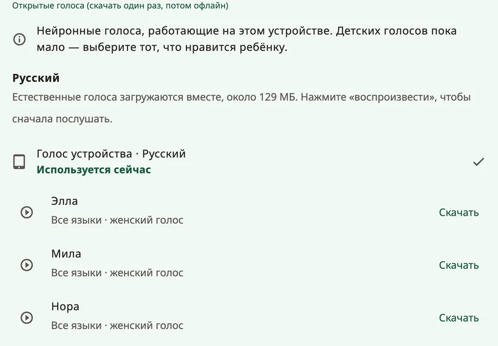

<!-- description: Как выбрать, каким голосом говорит ребёнок в Amalino: естественные голоса, голос устройства, записи, возраст голоса, скорость и произношение имени. -->
# Голоса

Голос — это голос ребёнка. Дайте ребёнку послушать несколько голосов и выбрать тот, который ему нравится. Поменять голос можно в любой момент: **{app:sectionSettings}** → **{app:speechVoice}**.

## Какие бывают голоса

- **{app:naturalVoicesHeading}**: десять голосов (Ella, Mila, Nora, Sofi, Ida, Leo, Theo, Adam, Omar и Ben), которые звучат наиболее по-человечески. Каждый из них говорит на всех семи языках Amalino. Все они скачиваются одним файлом, а потом работают без интернета.
- **{app:systemVoice}**: голоса, которые уже есть в телефоне или планшете. Скачивать ничего не нужно. Некоторым из них может требоваться интернет — Amalino пишет об этом под голосом.
- **{app:personalVoice}** (iPhone и iPad, iOS 17 или новее): голос, который вы создали в настройках устройства, в разделе **Универсальный доступ → Личный голос**. Amalino попросит разрешения им пользоваться. На Android функции «Личный голос» нет: чтобы сохранить голос кого-то из родных, запишите слова.
- **Ваши записи**: любое слово можно записать своим голосом в редакторе кнопки. Записи звучат вместо голоса приложения. Подробнее — на странице [Редактирование и перемещение кнопок](editing.md).

Нажмите на голос, чтобы послушать его, а затем нажмите **{app:useVoice}**.

## Один голос или свой для каждого языка

Голос настраивается для каждого языка отдельно. Но поскольку каждый естественный голос говорит на всех языках ребёнка, можно нажать **{app:useForAll|voice=…}** и оставить один голос для всего. Иначе во фразах, где смешаны языки, голос будет меняться.

## Загрузка

Естественные голоса скачиваются одним файлом примерно на 129 МБ. Amalino заранее сообщает размер. При мобильном интернете он спрашивает, прежде чем скачивать; выберите **{app:waitForWifi}**, чтобы скачать позже. Пока загрузка не закончилась, звучит голос устройства.

Чтобы освободить место, естественные голоса можно удалить с устройства; тогда слова будет произносить голос устройства, пока вы не скачаете их снова.

## Как звучит голос

- **{app:speechRate}**: медленнее или быстрее.
- **{app:voiceAge}**: **{app:voiceAgeAdult}**, **{app:voiceAgeOlder}** или **{app:voiceAgeYoung}**, и ползунок **{app:voiceAgeStrength}**. Эта настройка повышает тон и меняет характер голоса. Голос будет звучать скорее как маленький взрослый, чем как настоящий ребёнок, так что посмотрите, что понравится ребёнку.
- **{app:pitch}**: только для собственных голосов устройства, поэтому эта настройка видна, лишь когда звучит один из них. У естественных голосов вместо неё возраст голоса.
- **{app:volume}**.
- **{app:lowerOthers.anon}**: музыка и другие приложения звучат тише — **{app:lowerOthersSpeaking}** или **{app:lowerOthersOpen}**, — чтобы слова было лучше слышно.

## {app:savedSpeech}

Этот пункт находится в разделе **{app:advanced}** в конце экрана **{app:speechVoice}**. Чтобы слова звучали сразу, Amalino заранее готовит слова доски выбранными голосами и хранит их на устройстве. Это происходит в фоне, пока доской не пользуются. Пункт **{app:savedSpeech}** показывает, как идёт подготовка и сколько места занято. Если слова вдруг звучат неправильно, кнопка **{app:savedSpeechRebuild}** подготовит их заново.

## Имя ребёнка

В настройках для взрослых выберите пункт с именем ребёнка (например, **{app:settingsChildName|name=Сэм}**):

- напишите имя так, как оно пишется на каждом языке, или его короткую форму;
- послушайте, как его произносит каждый голос;
- если звучит неправильно, напишите в поле **{app:spokenAs}**, как имя слышится, например «Шон» вместо «Sean».

Если и так звучит неправильно, запишите имя своим голосом.

## Если для языка нет голоса

Если у какого-то языка пока нет голоса, скачайте естественные голоса. Или установите голос в настройках синтеза речи на устройстве, или запишите слова сами.

> **Совет.** Спросите ребёнка, какой голос ему нравится. Если голос ему подходит, пользоваться им хочется больше.

Далее: [Резервные копии, обмен и печать](sharing-and-printing.md).
