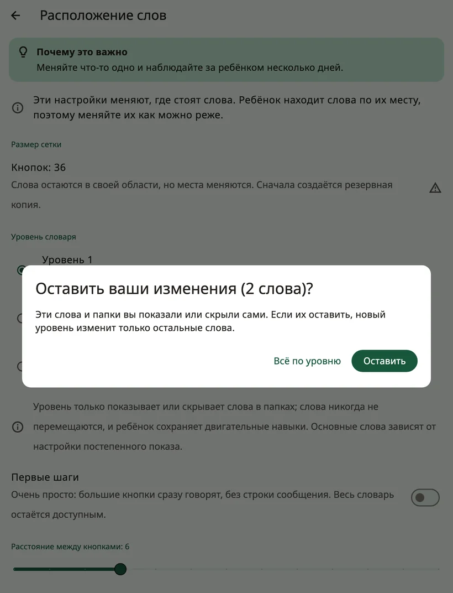

<!-- description: Как устроены слова в Amalino: основные слова на постоянных местах, папки, размер доски, уровни словаря и постепенное открытие скрытых слов. -->
# Слова и папки

В Amalino около 2500 слов на каждом из семи языков. Показывать их все сразу не нужно. На этой странице рассказано, как устроены слова и как открывать новые по мере того, как ребёнок растёт.

## Основные слова и папки

На **основной доске** — основные слова: короткие повседневные слова вроде «я», «хочу», «ещё», «пойти», «не», «помоги» и «нравится». Около 200 основных слов составляют большую часть того, что люди говорят каждый день, так что с ними ребёнок может сказать очень многое.

В **папках** — всё остальное: еда, места, люди, чувства, игрушки и многое другое. У кнопки папки загнут уголок, и она открывает страницу со связанными словами.

Когда ребёнок нажимает слово в папке, Amalino возвращается туда, откуда ребёнок пришёл, — к следующему слову: «я хочу», затем папка «еда», «яблоко», и вот основные слова снова на месте, чтобы добавить «пожалуйста». Для папок, где ребёнок выбирает несколько слов подряд, например «цвета», выключите для этой папки настройку **{app:folderGoBack}** (см. [Редактирование и перемещение кнопок](editing.md)). В папке **{app:favourites}** она с самого начала выключена.

## Размер доски

Размер доски (**{app:gridSize}**) — это то, сколько кнопок помещается на одной странице:

- **20**: {app:grid.20}
- **36**: {app:grid.36}
- **60**: {app:grid.60}
- **84**: {app:grid.84}

Размер предлагается при настройке, исходя из возраста ребёнка и того, как он касается экрана. Каждое устройство предлагает только те размеры, при которых любая кнопка не меньше 44 пунктов в ширину (около 7 мм — удобный размер для пальца).

Старайтесь не менять размер. Если его изменить, слова переедут на новые места, и ребёнку придётся учить их заново. Amalino попросит подтверждения и сначала сделает резервную копию. Лучше растить доску, открывая на ней новые слова.

## Слова никогда не сдвигаются

У каждого слова своё место, и оно за ним сохраняется. Если слово скрыто, его место остаётся пустым; когда слово откроют, оно появится именно там. Ничего не сдвигается, чтобы освободить место.

## Уровень словаря

**{app:sectionSettings}** → **{app:boardLayout}** → **{app:vocabLevel}** определяет, сколько слов видно в папках:

- **{app:levelDesc1|label}**: около 400 слов — основные слова и первые слова в папках
- **{app:levelDesc2|label}**: около 1300 слов, больше папок
- **{app:levelDesc3|label}**: все слова (около 2500)

Уровень только показывает или скрывает слова в папках. Слова на основной доске открываются по одному (см. ниже).

Если вы уже сами показывали или скрывали слова в папках, Amalino сначала спросит, оставить ли ваши изменения. **{app:keepOwnChangesKeep}** — новый уровень изменит только остальные слова; **{app:keepOwnChangesReset}** — каждое слово будет следовать новому уровню.

## Как показывать и скрывать слова

Каждое слово либо **видно** ребёнку, либо **скрыто**. Место скрытого слова ребёнку кажется пустым, и больше ничего не сдвигается.

Чтобы посмотреть и изменить это, откройте настройки для взрослых и выберите **{app:editBoard}**. Скрытые слова видны на своих местах — затемнённые и с перечёркнутым глазом. Нажмите на такое слово, включите в его редакторе **{app:visibility}** и нажмите **{app:done}**. Внутри папок всё работает так же.

В режиме показа страница папки работает так же: скрытые слова видны бледными, а значок глаза в строке показа сразу открывает все слова этой папки.

> **Совет.** Открывайте новое слово только после того, как много раз показали его сами. В режиме показа скрытые слова видны бледными на своих местах: нажимайте их, пока разговариваете, а когда ребёнок будет готов, удерживайте слово и выберите **{app:showToChild}**. Подробнее — в разделе [Настройки: режим показа](settings.md).

## Как найти слово

Не помните, где слово? Включите **{app:modellingMode}**, нажмите **{app:showMeWhere}** и введите слово. Amalino покажет путь к нему, кнопку за кнопкой, и вы сможете нажать его сами, пока разговариваете.

## Ваши собственные слова

Можно добавлять слова, менять картинки, записывать слово своим голосом, создавать новые папки или добавлять встроенные. Подробнее — на странице [Редактирование и перемещение кнопок](editing.md).

Далее: [Быстрые фразы и «{app:quickMore}»](quick-phrases.md).
