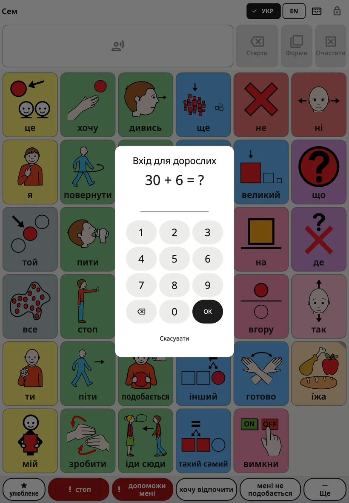
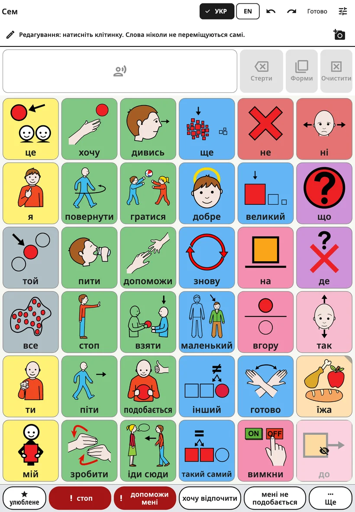
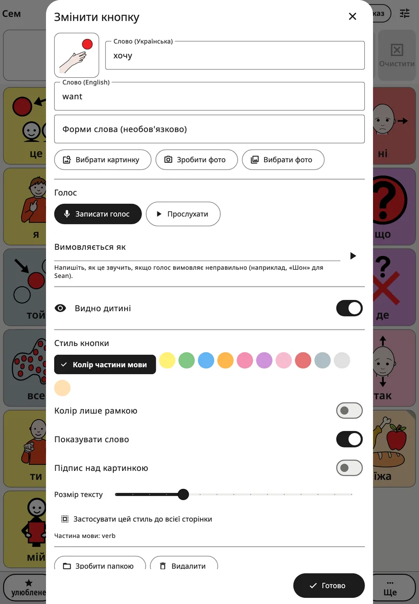
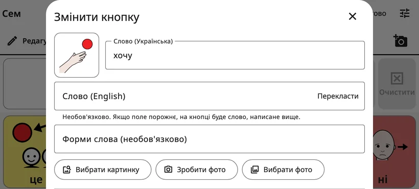
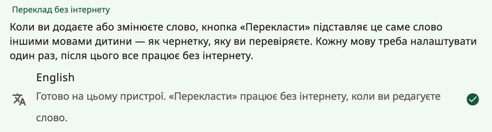

<!-- description: Як змінити дошку Amalino: налаштування для дорослих, слово, картинка й голос кнопки, переклад, нові папки, переміщення кнопок і відміна змін. -->
# Редагування й переміщення кнопок

У кожної родини свої слова. Ви можете змінити будь-яке слово, картинку чи голос, додати власні слова й папки, а також переміщувати додані вами кнопки. Дитина нічого з цього не бачить і змінити не може.

## Як відкрити налаштування для дорослих

У правому верхньому куті дошки **утримуйте замок 3 секунди**, а потім розвʼяжіть простий приклад (або введіть PIN-код) на цифрових кнопках, що зʼявляться. Відкриються налаштування для дорослих. Через 5 хвилин вони самі знову заблокуються, а якщо натиснути **{app:lockNow}** — одразу.

Час утримання, PIN-код і автоматичне блокування можна змінити в розділі **{app:lockAndKeep}**. Докладніше — на сторінці [Налаштування](settings.md).

## Як редагувати дошку

Виберіть **{app:editBoard}**. Угорі дошки зʼявиться рядок «{app:editingHint}», а на верхній панелі — кнопки **{app:undo}**, **{app:redo}** і **{app:done}**.

- Щоб відредагувати кнопку, натисніть на неї.
- Натисніть порожню клітинку й виберіть **{app:addWord}** або **{app:addFolder}**.
- Так само відкривайте папки й редагуйте кнопки в них.
- Коли закінчите, натисніть **{app:done}**.

Приховані слова видно на своїх місцях — затемнені й із перекресленим оком, тож під час редагування ви завжди бачите всю дошку.

## Редактор кнопки

- **Слово**: слово на кнопці поточною мовою дошки.
- **Інші мови дитини**: нижче — по одному полю для кожної з інших мов дитини, наприклад **{app:wordLabel|language=англійська}**. Заповнювати їх не обовʼязково: якщо поле порожнє, на кнопці буде слово, написане вище.
- **{app:translateWord}**: ця кнопка зʼявляється біля порожнього поля, якщо пристрій уміє перекладати цією мовою без інтернету. Вона вписує слово як чернетку з позначкою «{app:translatedCheck}» Перевірте його, перш ніж ним користуватиметься дитина. Див. «Переклад слів» нижче.
- **{app:wordFormsManual}**: інші форми слова через кому, наприклад «миші, мишу, мишці».
- **Картинка**: кнопка **{app:chooseSymbol}** шукає серед вбудованих картинок, а **{app:moreSymbolSets}** — в інших безкоштовних наборах символів в інтернеті; надсилаються лише слова, які ви шукаєте. Кнопки **{app:takePhoto}** і **{app:choosePhoto}** додають ваше власне фото. Фото найкраще підходять для людей, домашніх тварин і власних речей дитини.
- **{app:voice}**: кнопка **{app:recordVoice}** записує слово вашим голосом, **{app:listen}** відтворює запис, а **{app:removeRecording}** повертає голос застосунку.
- **{app:spokenAs}**: якщо голос вимовляє слово неправильно, напишіть, як воно має звучати, наприклад «Шон» для Sean.
- **{app:recInSentences}**: зазвичай ваш запис звучить лише тоді, коли дитина натискає саме цю кнопку, а в реченні слово вимовляє голос застосунку. Увімкніть це для звуків, пісень або слів, які голос не може вимовити.
- **{app:visibility}**: якщо ввімкнено, дитина бачить слово й користується ним; якщо вимкнено, місце слова здається дитині порожнім, і нічого не зсувається. Докладніше — на сторінці [Слова і папки](words-and-folders.md).
- **{app:buttonStyle}**: **{app:wordTypeColour}**, **{app:borderOnly}**, **{app:showLabel}**, **{app:labelOnTop}** і **{app:textSize}**. Кнопка **{app:styleWholePage}** поширює цей стиль на всі кнопки сторінки.
- **{app:wordType}**: від неї залежить колір кнопки (наприклад, дії — зелені, а слова, що описують, — сині).

Щоб поставити **нове** слово чи папку на дошку, натисніть унизу **{app:add}**. Кнопка **{app:add}** залишається сірою, доки в кнопки немає слова або картинки. **✕** скасовує все: нічого не додається, а фото чи запис, які ви для неї зробили, видаляються.

Коли ви редагуєте **наявну** кнопку, зміни застосовуються одразу; щоб закрити редактор, натисніть **{app:done}** (або **✕**).

## Переклад слів

Кнопка **{app:translateWord}** працює на пристрої, без інтернету, після того як мову налаштовано. Налаштуйте кожну мову один раз: у налаштуваннях для дорослих відкрийте **{app:languages}** (у розділі **{app:sectionBoards}**), а потім **{app:offlineTranslationHeader}**:

- **Android**: натисніть на мову й погодьтеся завантажити модель перекладу від Google — близько 30 МБ на кожну мову. Жодні слова із застосунку не надсилаються.
- **iPhone та iPad**: потрібна iOS 26 або новіша. Мови надає Apple: відкрийте на пристрої **Параметри → Програми → Переклад → Завантажені мови**, завантажте потрібні мови й поверніться в Amalino.

Біля кожної мови видно, чи вона готова. Якщо пристрій цього не підтримує, там написано **{app:offlineTranslationUnsupported}**

## Папки

Щоб додати папку, у режимі редагування натисніть порожню клітинку й виберіть **{app:addFolder}**. На екрані **{app:pickFolderTitle}** перелічено папки дитини з їхніми картинками, зокрема вбудовані («їжа», «почуття», «місця»…), а вгорі — **{app:newFolder}**. Виберіть папку, перевірте назву й картинку та натисніть **{app:add}**.

У редакторі кнопки папки є ще:

- **{app:makeFolder}**: перетворює кнопку зі словом на кнопку папки. Виберіть папку або **{app:newFolder}**.
- **{app:changeFolder}**: кнопка папки відкриватиме іншу папку.
- **{app:openThisFolder}**: закриває редактор і відкриває папку, щоб ви могли відредагувати її вміст.
- **{app:folderGoBack}**: якщо ввімкнено, після натискання слова в цій папці дитина повертається туди, звідки прийшла, і може вибирати наступне слово. Вимкніть це для папок, де дитина вибирає кілька слів поспіль. Налаштування діє для папки, звідки б її не відкрили. У папці **{app:favourites}** воно від початку вимкнене.

## Як перемістити кнопку

Основні слова на головній дошці не змінюють місць, тож рука дитини завжди їх знаходить. А кнопки, що відкривають папку чи сцену, можна переміщувати:

1. Відкрийте кнопку в редакторі й виберіть **{app:sceneMove}**
2. На екрані **{app:pickCellTitle}** видно дошку з підсвіченими вільними клітинками. Натисніть одну з них, а потім **{app:pickCellPutHere}**.
3. Або виберіть **{app:pickCellChooseAnother}**, щоб перенести кнопку в іншу папку, чи **{app:pickCellFavouritesInstead}**.

Кнопка зберігає своє слово, картинку, голос і стиль. Більше нічого на жодній із двох дошок не зсувається. Одне натискання **{app:undo}** повертає її на місце.

## Як видалити кнопку

Відкрийте кнопку в редакторі й виберіть **{app:delete}**. Для основного слова Amalino запропонує **{app:hideInstead}**: якщо слово приховати, його місце збережеться на потім, а після видалення залишиться порожня клітинка. Приховати майже завжди краще.

## Відміна змін та історія

- Кнопки **{app:undo}** і **{app:redo}** на верхній панелі дають змогу під час редагування крокувати назад і вперед вашими змінами.
- У розділі **{app:historyBackups}** налаштувань для дорослих перелічено всі зміни. Кнопка **{app:restoreHere}** повертає дошки до того стану, у якому вони були в той момент.

Помилятися не страшно. Будь-яку зміну можна відмінити.

> **Порада.** Додавши слово, самі скористайтеся ним на пристрої щонайменше тричі того ж дня.

Далі: [Налаштування, екран за екраном](settings.md).
