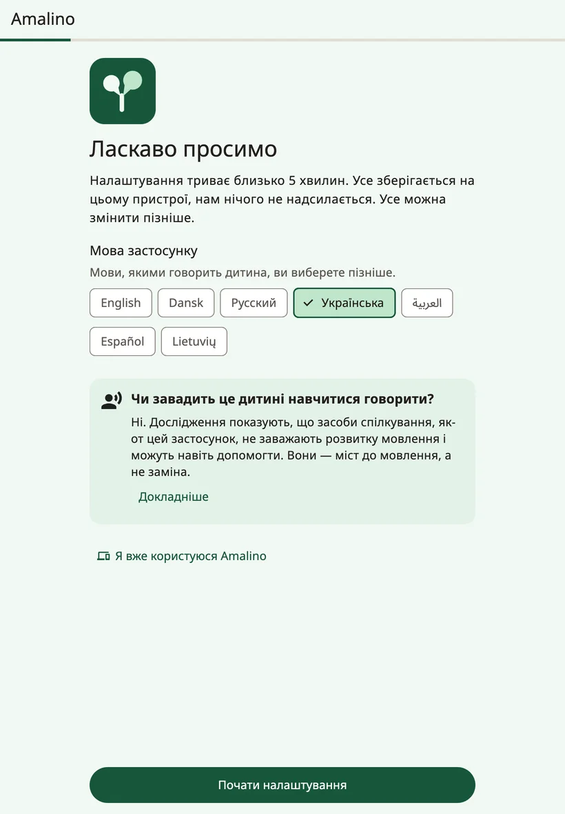
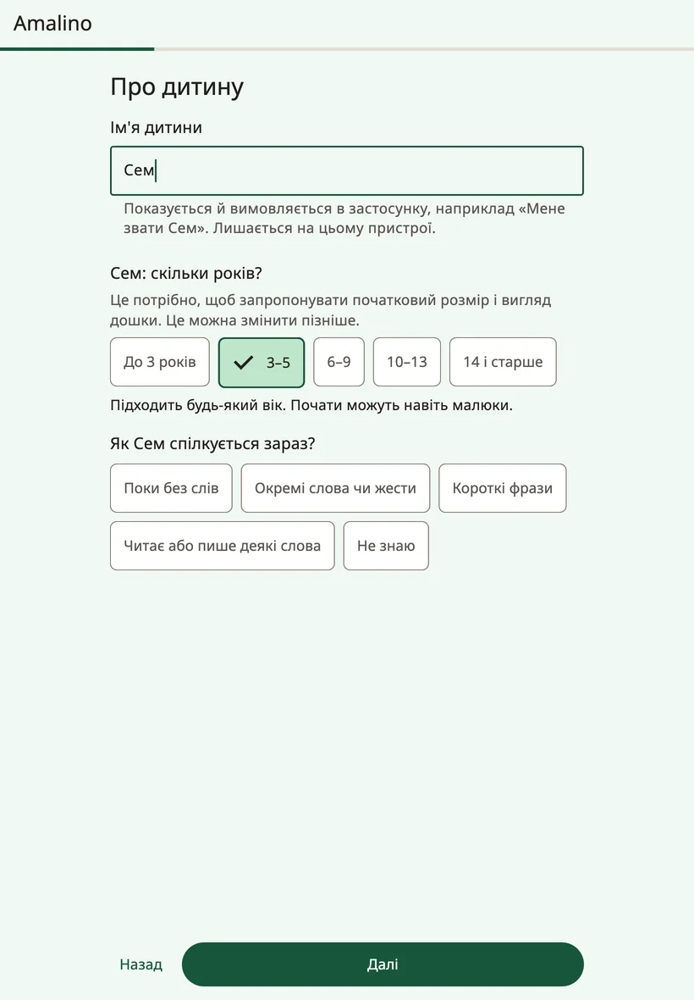
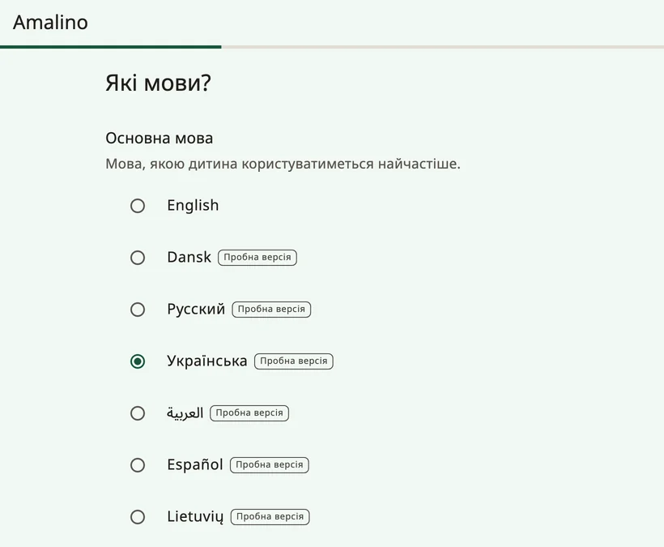
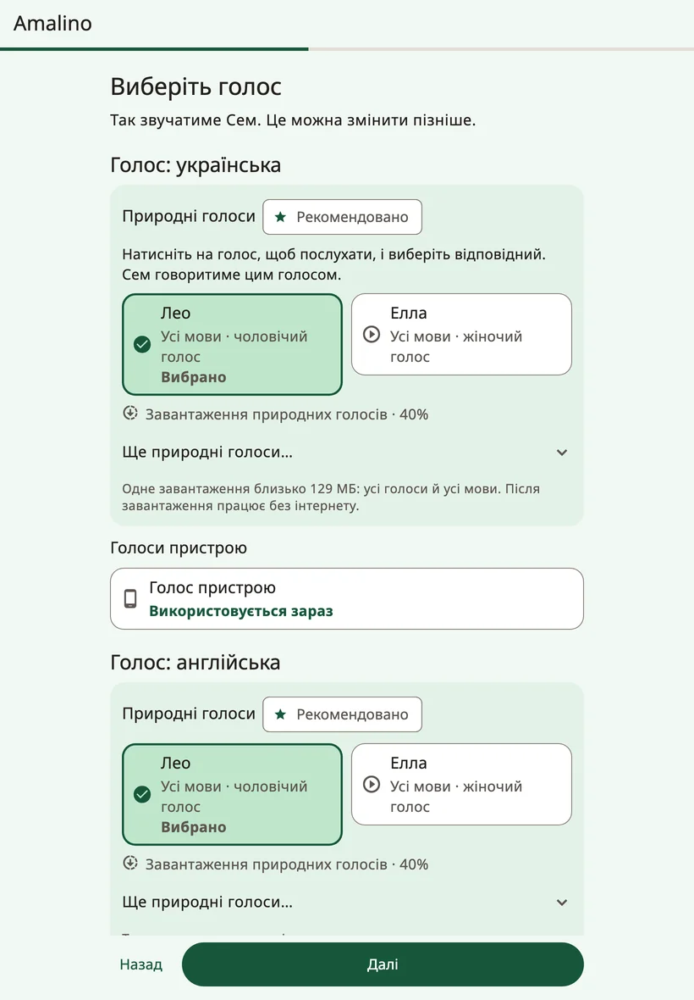
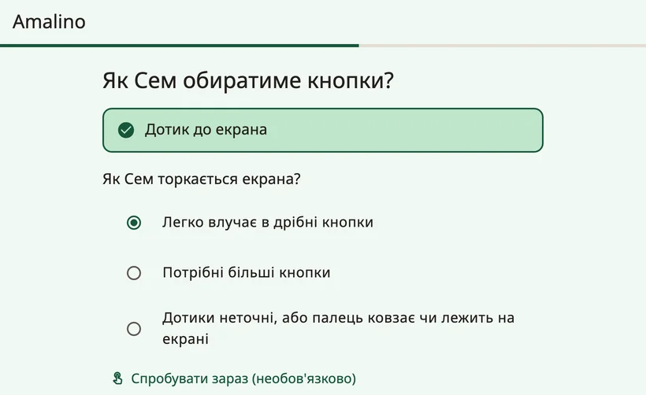
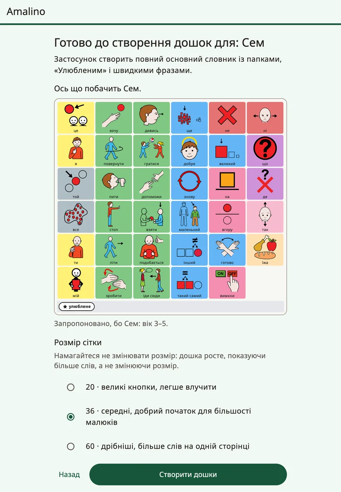

<!-- description: Перше налаштування Amalino: дитина, мови, голос, дотик, улюблені речі та блокування налаштувань для дорослих. -->
# Початок роботи

Amalino працює на iPhone, iPad, а також на телефонах і планшетах з Android. Він безкоштовний, а після налаштування працює без інтернету.

Налаштування триває близько пʼяти хвилин. Усе, що ви вводите, залишається на пристрої, і будь-яку відповідь можна змінити пізніше.

## Перш ніж почати

- Зарядіть пристрій і зробіть звук гучніше.
- Якщо можете, покличте дитину на крок із дотиком: корисно побачити, як вона натискає.
- По змозі підключіться до Wi-Fi: природні голоси завантажуються одним файлом розміром близько 129 МБ.

## Кроки налаштування

### {app:welcomeTitle}

У пункті **{app:appLanguage}** виберіть мову екранів для дорослих. Мови дитини ви виберете на одному з наступних кроків.

Якщо дитина вже користується Amalino на іншому пристрої, натисніть **{app:alreadyUse}**, а потім **{app:restoreBackup}**: так ви перенесете її дошки з резервної копії, яку раніше експортували з паролем. Докладніше — на сторінці [Обмін і друк](sharing-and-printing.md).

### {app:aboutChild}

- **{app:ageBandTitle.anon}** Залежно від віку застосунок пропонує початковий розмір дошки, рівень словника й оформлення. Підходить будь-який вік: починати можуть навіть зовсім малі діти.
- **{app:commTitle.anon}** Відповідь допомагає підібрати перші слова.
- **{app:childName}** (необовʼязково). Імʼя видно в застосунку, і воно звучить у фразах на кшталт «Мене звати…». Воно залишається на пристрої.

### Мови

У пункті **{app:primaryLanguage}** виберіть мову, якою дитина користуватиметься найчастіше, і позначте інші мови, які дитина щодня чує. В Amalino їх сім: англійська, данська, українська, російська, арабська, іспанська та литовська.

У кожній мові та сама кнопка стоїть на тому самому місці. Дитина перемикає мову одним дотиком, і їй не треба вивчати дошку наново.

Поки що всі мови, крім англійської, мають позначку **{app:languagePreview}**: носій мови ще перевірив не всі слова. Під списком є примітка: «{app:languagePreviewNote}» Будь-яке слово ви можете виправити й самі.

Для української, російської, арабської, іспанської та литовської під час налаштування зʼявляється ще й запитання **{app:wordFormsTitle.anon}** Виберіть варіант **{app:forms.boy}** або **{app:forms.girl}**, щоб у словах, які дитина каже про себе, були правильні закінчення.

Якщо вашої мови немає, натисніть **{app:notListed}**. Дошки можна створювати й так: запишіть кожне слово своїм голосом, і дошка відтворюватиме ваші записи.

### Голос

Виберіть, як звучатиме дитина кожною мовою. Натисніть на голос, щоб його послухати.

- **{app:naturalVoicesHeading}** звучать найбільш по-людськи. Десять голосів говорять усіма сімома мовами й завантажуються одним спільним файлом розміром близько 129 МБ. Після цього вони працюють без інтернету. Рекомендований голос уже вибрано за вас.
- **{app:systemVoice}** не потребує завантаження й готовий одразу. Він говорить, доки не завантажиться природний голос.

Через Wi-Fi завантаження починається само. Якщо ви на мобільному інтернеті, Amalino спершу запитає дозволу або зачекає на Wi-Fi.

Голос можна змінити будь-коли. Докладніше — на сторінці [Голоси](voices.md).

### Як дитина вибирає

Поки що дитина користується Amalino, торкаючись екрана. Інші способи вибору позначені «**{app:comingLater}**».

Далі дайте відповідь на запитання **{app:touchTitle.anon}**

- **{app:touch.easy}**
- **{app:touch.bigger}**
- **{app:touch.shaky}**

Від відповіді залежать налаштування дотику й розмір дошки. Кнопка **{app:tryItNow}** дає дитині кілька разів натиснути на екран, а якщо багато натискань не влучили, кнопка **{app:makeEasier}** усе підлаштує. Інші налаштування дотику — у розділі **{app:sectionSettings}** → **{app:touchAccess}**.

### {app:fiveFavourites}

Додайте до пʼяти речей, які дитина любить: бульбашки, мультик, бабусю. Сфотографуйте або виберіть готове фото й напишіть, як це називає дитина. Усе потрапить до папки **{app:favourites}**, до якої з будь-якої дошки — один дотик. Для людей і власних іграшок дитини найкраще підходять фото.

### Налаштування для дорослих

Налаштування захищені, щоб дитина випадково не змінила дошку. Щоб їх відкрити, **утримуйте замок угорі дошки 3 секунди, а потім розвʼяжіть простий приклад**. Спробуйте один раз прямо тут. Є й варіант **{app:longerHold}**.

Замість прикладу можна поставити **{app:lockPin}**. Старші діти вміють розвʼязувати приклади, тому для них PIN-код надійніший.

### Імʼя кожною мовою

Якщо ви вказали імʼя, можна написати, як воно пишеться кожною мовою, і послухати, як його вимовляє голос. Якщо звучить неправильно, напишіть так, як воно має звучати, наприклад «Шон» для Sean.

### Підсумок

На останньому кроці видно всі ваші відповіді. Щоб змінити будь-яку з них, натисніть **{app:change}** поруч.

Тут ви також вибираєте:

- **{app:gridSize}** — скільки кнопок уміщується на дошці. Кнопка **{app:moreSizes}** показує решту варіантів. Намагайтеся не змінювати розмір: дошка росте за рахунок того, що на ній відкривається більше слів, а не за рахунок нового розміру.
- **{app:vocabLevel}** — близько 400, 1 300 або 2 500 слів. Докладніше — на сторінці [Слова і папки](words-and-folders.md).

Для старших дітей можна ввімкнути **{app:teenPack}**: соціальні фрази, жарти й сленг, а також доросліше оформлення без мультяшних картинок.

Для зовсім маленьких дітей, які тільки починають, застосунок може запропонувати **{app:earlyOffer|label}**: чотири великі картинки, які говорять одразу після натискання. Повний словник при цьому нікуди не дінеться, і пізніше можна перейти на повну дошку.

Потім натисніть **{app:createBoards}**.

## Після налаштування

На сторінці **{app:allSet}** ще раз показано, як відкрити налаштування для дорослих, і є перша порада, яку можна спробувати вже сьогодні. Там також є пункт **{app:lockDeviceToApp}** (з тими самими інструкціями, що й пункт **{app:guidedAccess}** в налаштуваннях для дорослих) і пункт **{app:dailyTip}**.

Натисніть **{app:startTalking}**. Відкриється дошка, готова для дитини.

Дещо можна зробити й пізніше: у налаштуваннях для дорослих є розділ **{app:finishSetup}**, де можна:

- вибрати дві фрази, які дитині потрібні найбільше;
- послухати, як звучить імʼя дитини;
- випробувати налаштування дотику разом із дитиною.

Далі: [Дошка дитини](the-board.md).
