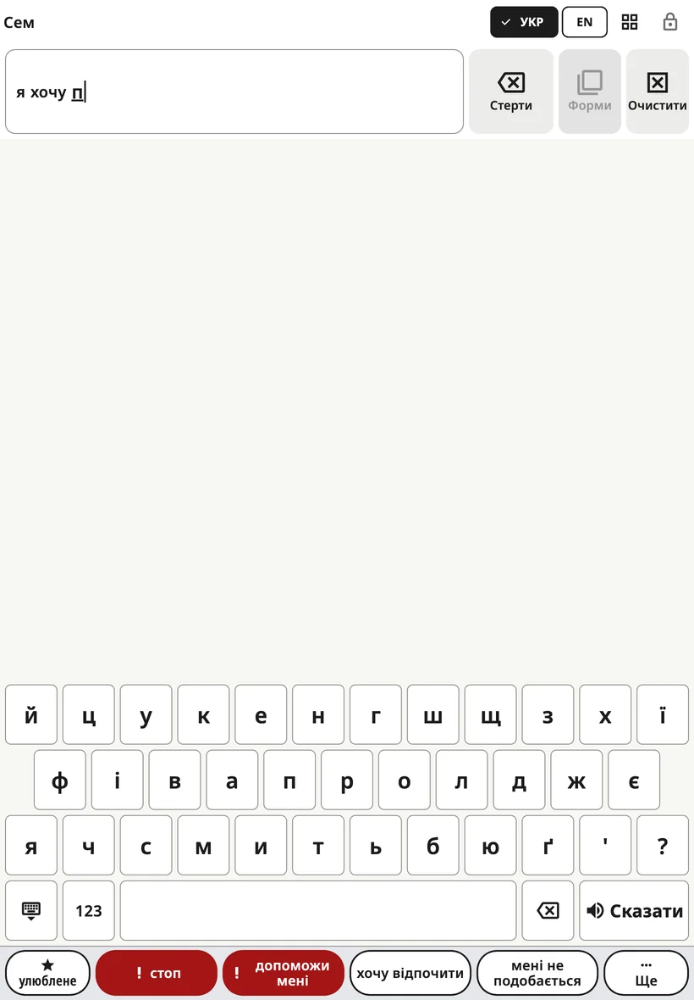

<!-- description: Як друкувати в Amalino: як відкрити клавіатуру, підказки слів, порядок літер, цифри й знаки, розмір клавіш на телефоні. -->
# Клавіатура

Діти, які вже знають деякі літери, можуть надрукувати слова, яких немає на дошці. Клавіатура відкривається на тому самому місці, що й дошка, тож перемикатися між ними — один дотик.

## Як відкрити й закрити клавіатуру

Натисніть кнопку **клавіатури** на верхній панелі. Щоб повернутися до картинок, натисніть ту саму кнопку ще раз (тепер на ній зображено сітку) або клавішу **закриття** в лівому нижньому куті клавіатури.

## Як друкувати

- Слово, яке дитина друкує, зʼявляється в **рядку повідомлення**, тож вона бачить, як воно росте.
- **Пробіл** завершує слово.
- **Клавіша стирання** видаляє літеру. Якщо її утримувати, літери стиратимуться далі.
- Кнопка **{app:kbSpeak}** промовляє все повідомлення.
- **123** відкриває цифри й розділові знаки, зокрема особливі знаки кожної мови (¿ ¡ в іспанській, » « в данській, « » в українській і російській, „ “ в литовській, ؟ ، в арабській). **ABC** повертає до літер.
- Клавіша **´** ставить знак наголосу в будь-якому порядку: можна набрати літеру й натиснути ´, а можна спершу натиснути ´, а потім літеру. На іспанській клавіатурі вона стоїть після ñ і дає á é í ó ú; повторне натискання прибирає знак, а на u дає спершу ú, потім ü (pingüino). На данській клавіатурі вона на сторінці **123** і дає é, як в idé, café та én.
- Якщо натиснути ´ перед літерою (на початку слова або після приголосної), клавіша темнішає, а в рядку повідомлення зʼявляється світлий знак ´: його отримає наступна голосна. Будь-яка інша клавіша, повторне натискання ´ або **клавіша стирання** його скасовують. На данській клавіатурі літери повертаються самі.

Кнопки рядка повідомлення **{app:barDelete}** й **{app:barClear}** працюють так само, як на дошці.

На телефоні, коли дитина торкається літери, над пальцем зʼявляється збільшена літера, тож дитина бачить, на якій клавіші палець, ще до того, як його відпустити. Цього не буває, якщо ввімкнено **{app:activateOnRelease}** і задано **{app:holdTime}**: тоді клавіша й так темнішає, поки її утримують.

## Підказки слів

Над клавішами є рядок, де зʼявляються підказки слів, поки дитина друкує. Натискання додає слово й пробіл. Підказки беруться:

- зі слів на дошках дитини;
- з того, що дитина друкувала раніше, якщо ввімкнено **{app:kbLearn.anon}**;
- зі списку слів для цієї мови.

В іспанській і данській слово можна набирати без цих знаків: на cancion зʼявиться підказка canción, на ide — idé.

Підказки створюються на пристрої; нікуди нічого не надсилається.

Дехто вимикає підказки, поки дитина вчиться писати слова: **{app:sectionSettings}** → **{app:kbSettings}** → **{app:kbSuggestions}**.

Якщо ввімкнено **{app:aiPhrase}** (у розділі **{app:sectionSettings}** → **{app:kbSettings}**), то після перших літер, наприклад «хпнм», може зʼявитися додаткова підказка «хочу піти на майданчик». Дитина може вибрати її або не звертати на неї уваги.

## Порядок літер

**{app:sectionSettings}** → **{app:kbSettings}** → **{app:kbLayout}**:

- **{app:kbLayoutStandard}**: звична клавіатура цієї мови.
- **{app:kbLayoutAbc}**: літери за абеткою, у тих самих рядах, тож клавіатура має той самий розмір.

## Розмір клавіш на телефоні

На телефоні в мові з великою кількістю літер клавіші виходять вузькими. **{app:sectionSettings}** → **{app:kbSettings}** → **{app:kbKeySize}**:

- **{app:kbKeySizeAuto}** (за замовчуванням) — залежно від налаштувань дотику: якщо дитині потрібні більші кнопки або її дотики неточні, довгі ряди літер розбиваються надвоє зі збереженням порядку літер, тож кожна клавіша має щонайменше 40 точок завширшки (близько 6 мм).
- **{app:kbKeySizeStandard}** — завжди звичні ряди.
- **{app:kbKeySizeLarger}** — довгі ряди розбиваються завжди.

Коли телефон повернуто горизонтально, клавіші й так широкі, тож ряди не розбиваються. На планшетах завжди звичні ряди.

## Коли телефон повернуто горизонтально

Якщо на телефоні для дошки задано альбомну орієнтацію, клавіатурі потрібна вся висота екрана. Тоді «**стоп**» і «**допоможи мені**» переходять у кінець рядка підказок, щоразу на те саме місце. Повний рядок фраз повертається, коли ви знову переходите до дошки.

> **Порада.** Показуйте й те, як друкувати. Повільно надрукуйте слово, вимовляючи його, а потім натисніть **{app:kbSpeak}**.

Далі: [Сцени](scenes.md).
