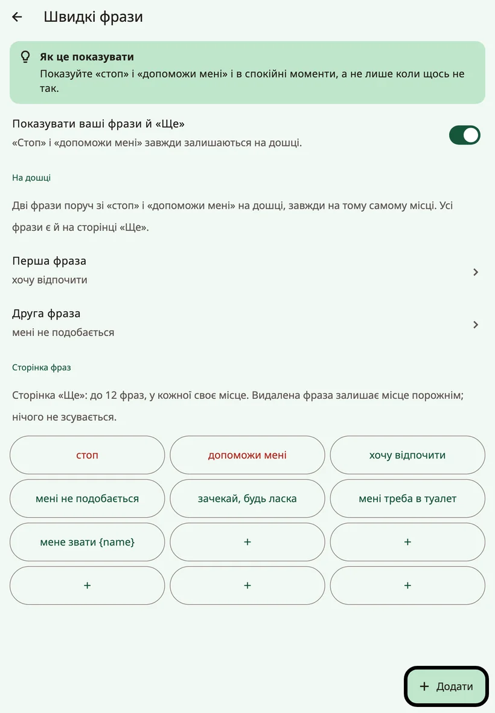
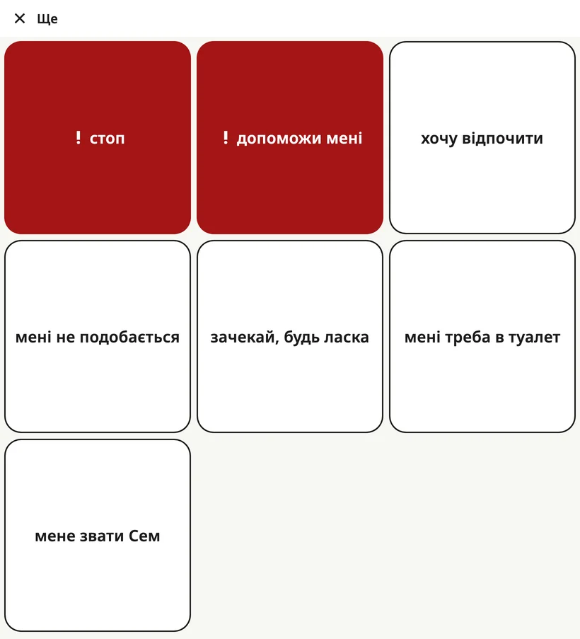

<!-- description: Рядок фраз унизу дошки Amalino: «стоп», «допоможи мені», дві фрази родини, папка «Улюблене» і сторінка фраз «Ще». -->
# Швидкі фрази і «Ще»

Деякі речі треба сказати швидко, не складаючи речення. **Рядок фраз** унизу дошки тримає їх на відстані одного дотику, на кожній сторінці.

## Рядок фраз

Зліва направо:

1. **★ {app:favourites}**: відкриває папку «{app:favourites}».
2. **! стоп**
3. **! допоможи мені**
4. **Перша фраза родини**
5. **Друга фраза родини**
6. **{app:quickMore}**: відкриває сторінку з усіма фразами.

Кожна кнопка має своє місце в усіх мовах і на всіх сторінках. «**Стоп**» і «**допоможи мені**» є завжди й завжди червоні: це термінові фрази. Чотири кнопки з фразами однакової ширини, тож довга фраза нічого не відсуває, а просто переноситься на другий рядок.

Фраза звучить одразу після натискання. До рядка повідомлення вона не додається.

## Як вибрати дві фрази родини

Відкрийте налаштування для дорослих і виберіть **{app:quickPhrases}**. У розділі **{app:qpOnBoard}** заповніть пункти **{app:qpPick1}** і **{app:qpPick2}** — це місця поруч зі «стоп» і «допоможи мені». Виберіть дві фрази, які дитині потрібні найбільше, наприклад «хочу відпочити» і «мені не подобається».

## Сторінка «{app:quickMore}»

Кнопка **{app:quickMore}** відкриває сторінку, на якій до 12 фраз, кожна на своєму постійному місці. Натискання промовляє фразу й закриває сторінку; кнопка **{app:close}** повертає назад, нічого не промовляючи.

У розділі **{app:quickPhrases}**, у підрозділі **{app:qpPage}**, можна:

- додати фразу кнопкою **{app:add}** і вибрати її місце (**{app:qpPlace}**);
- змінити фразу кнопкою **{app:edit}** або позначити її як **{app:qpUrgent}**, щоб вона була червоною;
- видалити фразу кнопкою **{app:delete}**. Її місце залишається порожнім, а інші фрази не зсуваються.

Коли сторінка заповнена, приберіть якусь фразу або натисніть **{app:makePhraseBoard}**, щоб перетворити фрази на папку, де вистачить місця для нових.

Фрази з імʼям дитини, як-от «мене звати…», зʼявляються, щойно ви додасте імʼя.

## {app:favourites}

У папці **{app:favourites}** — те, що дитина любить найбільше: пʼять улюблених речей із налаштування і все, що ви додасте пізніше. З будь-якої сторінки до неї один дотик — через кнопку **★ {app:favourites}**.

На головній дошці теж залишено одне вільне місце для «{app:favourites}»: коли ви вибираєте, куди поставити нову кнопку, на ньому є напис {app:pickCellFavouritesNote}.

На маленьких телефонах кнопка ★ може показувати лише зірочку без слова. Працює вона так само.

## Як приховати фрази родини

Якщо рядок відволікає дитину, вимкніть **{app:showQuickPhrases}** у розділі **{app:quickPhrases}**. Ваші дві фрази й кнопка **{app:quickMore}** зникнуть, але «**стоп**» і «**допоможи мені**» завжди залишаються на дошці, на тих самих місцях: часто це найважливіші слова, які має дитина. Кнопка **★ {app:favourites}** теж залишається.

> **Порада.** Показуйте «стоп» і «допоможи мені» й у спокійні хвилини, а не лише тоді, коли щось пішло не так.

Далі: [Клавіатура](keyboard.md).
