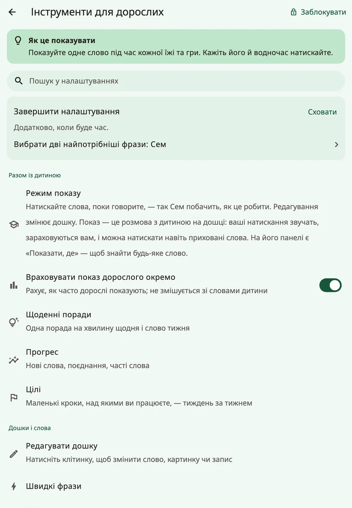
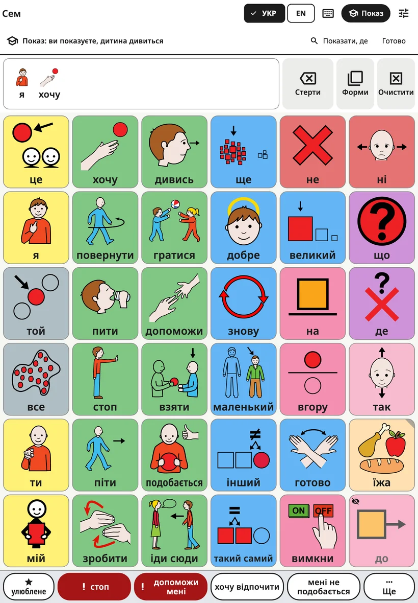
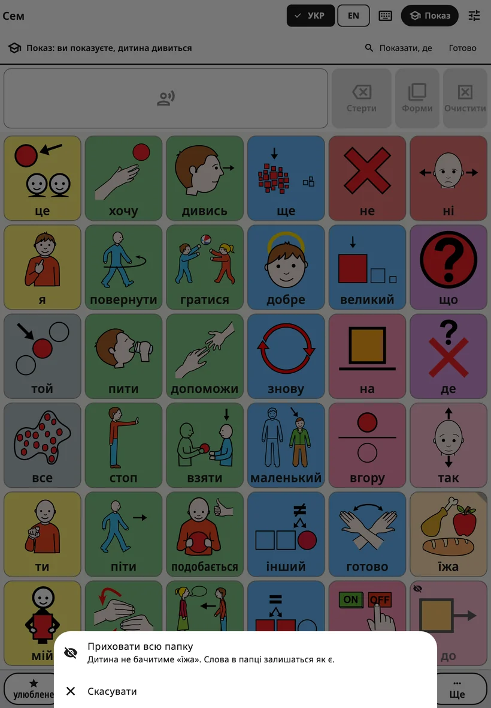
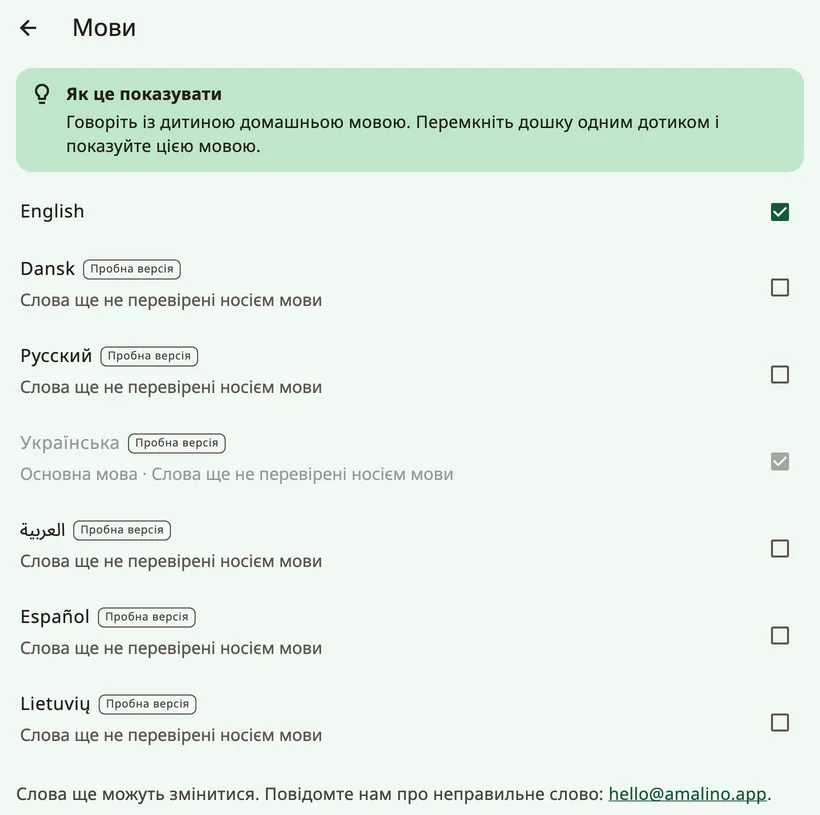
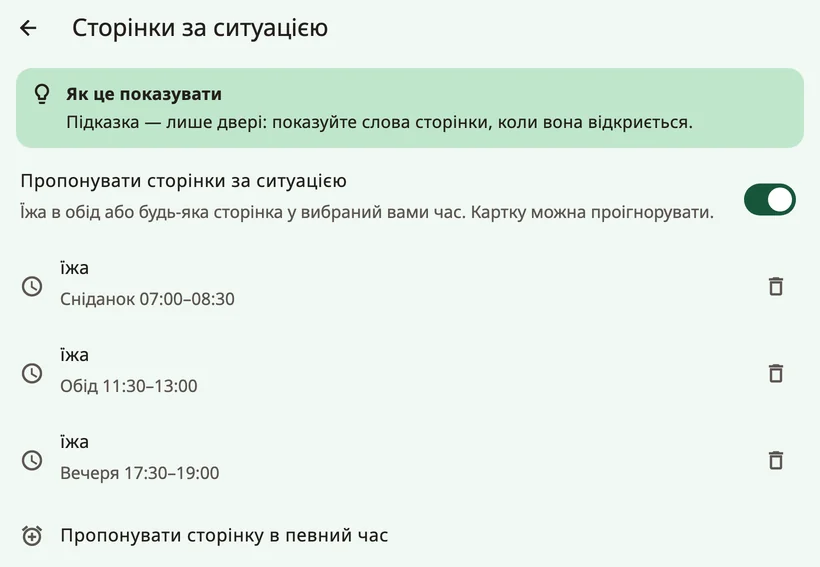

<!-- description: Усі екрани налаштувань для дорослих в Amalino: показ, слова, голоси, дотик, екран, розташування слів, клавіатура, підказки, блокування й дані. -->
# Налаштування, екран за екраном

Щоб відкрити налаштування для дорослих, утримуйте замок угорі дошки 3 секунди й розвʼяжіть приклад на цифрових кнопках. Налаштування поділено на чотири групи: **{app:sectionTogether}**, **{app:sectionBoards}**, **{app:sectionSettings}** і **{app:sectionData}**. На цій сторінці вони описані в тому порядку, у якому ви їх бачите. Запис «{app:sectionSettings} → …» в цій інструкції означає групу **{app:sectionSettings}** в налаштуваннях для дорослих, а не системні налаштування («Параметри») вашого пристрою.

На більшості екранів є коротка порада **{app:tipTitle}**.

## Як знайти налаштування

Не памʼятаєте, де щось лежить? Натисніть угорі **{app:searchSettings}** і введіть слово, наприклад «голос» чи «колір». Біля кожного результату видно, де він розташований («{app:speechVoice} → {app:speechRate}»). Натисніть на результат, і Amalino відкриє потрібний екран, ненавʼязливо позначивши налаштування.

## {app:sectionTogether}

### {app:modellingMode}

Пункт **{app:editBoard}** змінює саму дошку, а **{app:modelShort}** потрібен, щоб розмовляти з дитиною за допомогою дошки: ви натискаєте слова, поки говорите, і так показуєте, як це робиться. Ваші натискання промовляються й зараховуються як ваші, а не як слова дитини.

Найшвидше ввімкнути показ так: поки налаштування для дорослих відкриті, натисніть **{app:modelShort}** на верхній панелі дошки (на телефоні — значок академічної шапочки). Пункт **{app:modellingMode}** в меню робить те саме. Угорі зʼявляється рядок «{app:modellingOn}». У цьому рядку кнопка **{app:showMeWhere}** допоможе знайти слово: введіть його, і Amalino покаже шлях до нього, кнопку за кнопкою.

- **Приховані слова** видно блідими, з маленьким перекресленим оком, на тих місцях, де вони згодом зʼявляться в дитини. Натискайте їх, як будь-які інші слова: так дитина чутиме й бачитиме ці слова задовго до того, як вони зʼявляться на її власній дошці. Сама дитина й далі бачить там порожнє місце.
- **{app:showToChild}**: коли вважаєте, що дитина готова, утримуйте приховане слово якусь мить і виберіть **{app:showToChild}**. Кнопка **{app:undo}** поверне все як було.
- **Приховати слово чи цілу папку**: утримуйте слово, яке бачить дитина, і виберіть **{app:hideFromChild}**. Якщо утримувати кнопку папки, можна одразу показати чи приховати всю папку; коротке натискання, як і раніше, її відкриває.

- **Режим вимикається сам** через дві хвилини після вашого останнього натискання, а також щоразу, коли блокуються налаштування для дорослих, тож дитина ніколи не залишиться в режимі показу. Щоб вийти самостійно, натисніть **{app:done}** або ще раз **{app:modelShort}**.

Докладніше — на сторінці [Поради для родин](tips-for-families.md).

Поруч є налаштування **{app:logModelTaps}**: воно рахує, як часто показують дорослі, і ніколи не змішує це зі словами дитини.

### {app:coaching}

Щодня одна порада щодо показу на 60 секунд, а також **{app:wordOfWeek}**: до 3 слів, які дорослі показують цього тижня; у режимі показу вони підсвічені. **{app:dailyReminder}** надсилає сповіщення в час, який ви виберете; дозволу на сповіщення застосунок попросить лише тоді, коли ви це ввімкнете.

Тут є й розділ **{app:mythBuster}**: короткі відповіді на поширені тривоги («{app:myth.speech.q}») з посиланнями на дослідження.

### {app:progress} і {app:goals}

- **{app:progress}**: нові слова, поєднання слів і слова, якими дитина користується найчастіше. Зведення **{app:thisWeek}** коротко підсумовує тиждень — його можна надіслати всім, хто спілкується з дитиною, — і пропонує одне слово, яке варто показувати далі.
- **{app:goals}**: маленькі кроки, над якими ви працюєте тиждень за тижнем, як-от кількість днів із застосунком, нові слова чи кількість слів у реченні.

Використовуйте ці числа, щоб вирішити, що показувати далі, а не щоб перевіряти дитину.

## {app:sectionBoards}

- **{app:editBoard}**: див. [Редагування й переміщення кнопок](editing.md). Там же слова показують і приховують.
- **{app:quickPhrases}**: див. [Швидкі фрази і «Ще»](quick-phrases.md).
- **{app:languages}**: основна мова та інші мови. Мови, слова яких ще перевіряють, мають позначку **{app:languagePreview}** і рядок про те, як повідомити про неправильне слово. **{app:englishSpelling}** (британське чи американське) можна задати окремо на кожному пристрої. У розділі **{app:translationReview}** перелічено слова кожної мови, які ще треба перевірити, тож ви можете перевірити або виправити їх. У пункті **{app:offlineTranslationHeader}** переклад налаштовують окремо для кожної з інших мов дитини; див. [Редагування й переміщення кнопок](editing.md).
- **{app:boardBuilder}**: введіть тему, наприклад «день народження», і отримайте готову сторінку для неї. Це працює на пристрої й охоплює близько 20 повсякденних тем (день народження, лікар, парк, купання, час спати, зоопарк, пляж тощо). Перш ніж зберегти сторінку, ви перевіряєте слова.
- **{app:symbolSets}**: вбудовані картинки ARASAAC, давніші картинки Mulberry, які ще є на деяких дошках, ваші власні фото, а також необовʼязковий пошук серед усіх картинок ARASAAC (близько 13 000), за якого картинка завантажується, коли ви її вибираєте. «**{app:useNewPictures}**» замінює на новіші ті картинки вбудованих слів, які ще не змінювали. Ваші власні картинки й фото залишаються. ARASAAC безкоштовний для некомерційного використання.
- **{app:printBoards}**: див. [Обмін і друк](sharing-and-printing.md).

## {app:sectionSettings}

### Імʼя дитини

Імʼя і те, як воно пишеться кожною мовою. Тут також можна налаштувати, як його вимовляти. Докладніше — на сторінці [Голоси](voices.md).

### {app:speechVoice}

Голос для кожної мови, кнопка на кшталт **{app:useForAll|voice=Ella}**, **{app:personalVoice}**, **{app:speechRate}**, **{app:voiceAge}**, **{app:volume}** і **{app:soundCheck}**. Налаштування **{app:pitch}** видно лише тоді, коли говорить один із голосів пристрою. **{app:savedSpeech}** — наприкінці, у розділі **{app:advanced}**. Докладніше — на сторінці [Голоси](voices.md).

### {app:touchAccess}

Як дошка реагує на дотик. Змінюйте щось одне за раз і кілька днів спостерігайте за дитиною.

У пункті **{app:accessMethod}** показано дотик до екрана; інші способи вибору позначено як **{app:comingLater}**. **{app:highlightSpeaking}** злегка підфарбовує кнопку, поки звучить її слово.

У розділі **{app:touchTuning}** — усе інше:

- **{app:holdTime}**: скільки часу палець має пробути на кнопці, перш ніж вона заговорить. Допомагає, коли рука випадково зачіпає екран, але швидке натискання тоді не спрацює. Якщо задано час утримання, форми слова відкриваються лише кнопкою **{app:barForms}**.
- **{app:repeatIgnore}**: друге натискання на ту саму кнопку невдовзі після першого не враховується.
- **{app:activateOnRelease}**: дитина може ковзнути пальцем до потрібної кнопки, перш ніж натискання зарахується.
- **{app:targetEnlargement}**: кожна кнопка реагує й трохи за своїм краєм.
- **{app:tremorFilter}**: для рук, що тремтять; зараховується кнопка за варіантом **{app:tremor.firstLanding}** або **{app:tremor.longestDwell}**.
- **{app:palmRejection}**: долоня чи рука, що лежить на екрані, не натискає кнопок.
- **{app:practice}**: тренувальна дошка, яка рахує натискання, проігноровані дотики й промахи між кнопками.

### {app:displaySensory}

Як виглядає дошка. Тут усе можна сміливо пробувати: нічого не переїжджає.

- **{app:theme}**: **{app:theme.standard}**, **{app:theme.calm}**, **{app:theme.dark}**, **{app:theme.highContrast}** або **{app:theme.teen}**.
- **{app:colourCoding}**: **{app:palette.fitzgerald}**, **{app:palette.calm}**, **{app:palette.colorBlindSafe}** або **{app:palette.none}**. **{app:borderOnly}** дає спокійніший вигляд.
- **{app:showLabels}**, **{app:labelOnTop}** і **{app:textSize}**.
- **{app:reduceMotion}**: як у налаштуваннях пристрою, або завжди ввімкнено чи завжди вимкнено.

### {app:boardLayout}

«{app:boardLayoutNote}»

- **{app:gridSize}**: див. [Слова і папки](words-and-folders.md). На планшеті зʼявляється примітка, якщо за 84 кнопок у вертикальній орієнтації деякі довгі слова не вмістяться повністю.
- **{app:boardOrientation}**: лише для телефонів. Дошка, клавіатура й сцени залишаються вертикальними (або горизонтальними), а екрани для дорослих і далі повертаються. Якщо в іншій орієнтації вміщується менше кнопок, Amalino спершу запитає.
- **{app:vocabLevel}**: див. [Слова і папки](words-and-folders.md).
- **{app:earlyMode}**: дуже прості великі кнопки, які говорять одразу, без рядка повідомлення. Повний словник при цьому нікуди не дінеться.
- **{app:cellGap}**.

### {app:messageBar}

- **{app:showMessageBar}**.
- **{app:speakEachWord}** (за замовчуванням увімкнено). Якщо вимкнути, натискання на слово лише додає його до повідомлення, і нічого не звучить, доки не натиснути на рядок повідомлення.
- **{app:clearAfterSpeak}**.
- **{app:grammarHelper}**: утримуйте слово, щоб вибрати іншу форму («собаки», «пішов», «більший»…). Увімкнено в усіх мовах. Докладніше — на сторінці [Дошка дитини](the-board.md).

### {app:kbSettings}

**{app:kbSuggestions}**, **{app:kbLearn.anon}**, **{app:aiPhrase}**, **{app:kbLayout}** і **{app:kbKeySize}**. Докладніше — на сторінці [Клавіатура](keyboard.md).

### {app:aiHelpers}

Помічники, які пропонують слова. Вони ніколи не говорять замість дитини: вибирає завжди дитина. У кожного помічника свій вмикач, і всі вимкнені, доки ви їх не ввімкнете. Працюють вони на пристрої:

- **{app:aiNextWord}**: ненавʼязливо обводить 2–3 кнопки. Кнопки ніколи не переїжджають. Навчається лише на цьому пристрої.
- **{app:contextBoards}**: пропонує сторінку в певний час доби, наприклад сторінку «їжа» в обідню пору. Враховує лише час доби, ніколи не ваше місцезнаходження чи календар. Сторінку пропонує картка на дошці: один дотик її відкриває, а дитина може не звертати на неї уваги. На екрані цієї функції ввімкніть **{app:aiContext}**, а потім натисніть **{app:addMealRules}** або **{app:addTimeRule}**, щоб вибрати сторінку й час.
- **{app:aiListen}**: коли ви вмикаєте мікрофон на верхній панелі, пристрій слухає, що кажете ви, і підсвічує слова, якими дитина могла б відповісти. Мовлення розпізнається на пристрої; звук ніколи не зберігається й не надсилається. Для цього потрібно один раз завантажити розпізнавання мовлення.

### {app:lockAndKeep}

- **{app:editLock}**: **{app:lockChallenge}** або **{app:lockPin}** (4–8 цифр); і те, і те вводиться на цифрових кнопках на екрані. PIN-код діє для всього пристрою: той самий PIN відкриває налаштування для дорослих для кожної дитини на ньому. Якщо на пристрої немає блокування екрана, Amalino спершу покаже **код відновлення** — запишіть його й зберігайте окремо від пристрою. Якщо забудете PIN-код, натисніть **{app:forgotPin}** і задайте новий за допомогою блокування екрана або коду відновлення.
- **{app:holdSeconds}**: скільки треба утримувати замок.
- **{app:relockAfter}**: як швидко налаштування для дорослих заблокуються самі.
- **{app:guidedAccess}**: покрокові інструкції для функції **Керований доступ** на iPad та iPhone і **закріплення застосунку** на Android (на планшетах Samsung — також Samsung Kids). Дитина й далі може говорити, просто не може вийти із застосунку.

## {app:sectionData}

- **{app:historyBackups}**: відмінити будь-яку зміну, одразу створити резервну копію, експортувати її з паролем або відновити. Докладніше — на сторінці [Обмін і друк](sharing-and-printing.md).
- **{app:openBoardFormat}**: перенесення дошок в інші застосунки АДК і з них. Докладніше — на сторінці [Обмін і друк](sharing-and-printing.md).
- **{app:profiles}**: у кожної дитини свої дошки й слова. Кнопка **{app:addChild}** — для брата чи сестри на тому самому пристрої.
- **{app:about}**: приватність, посилання на сторінку **{app:privacyPolicy}**, ліцензії картинок і голосів, а також зворотний звʼязок. **{app:diagnostics}** наприкінці показує технічні подробиці, наприклад, як швидко натискання перетворюється на мовлення. Якщо щось не працює, я можу попросити вас надіслати ці дані.

## Згодом

Деяким функціям потрібен онлайн-сервіс: **{app:syncTitle}** між пристроями, **{app:library}**, **{app:lessonPages}** і **{app:aiCloud}**. У цій версії застосунку такого сервісу немає, тому в меню їх не видно.

Далі: [Голоси](voices.md).
