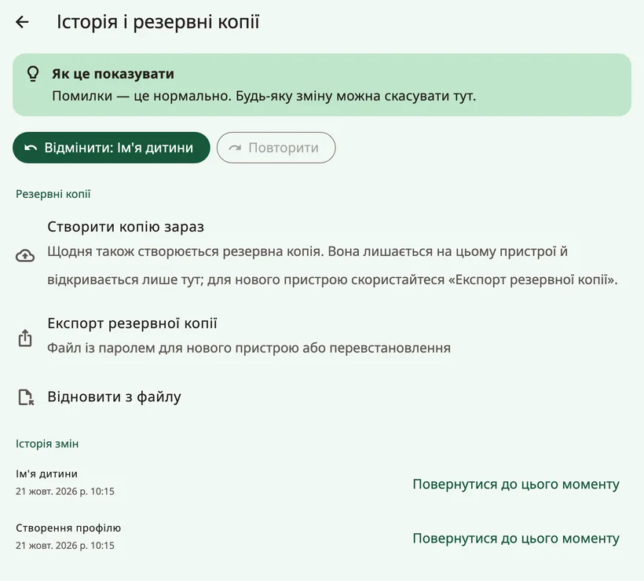
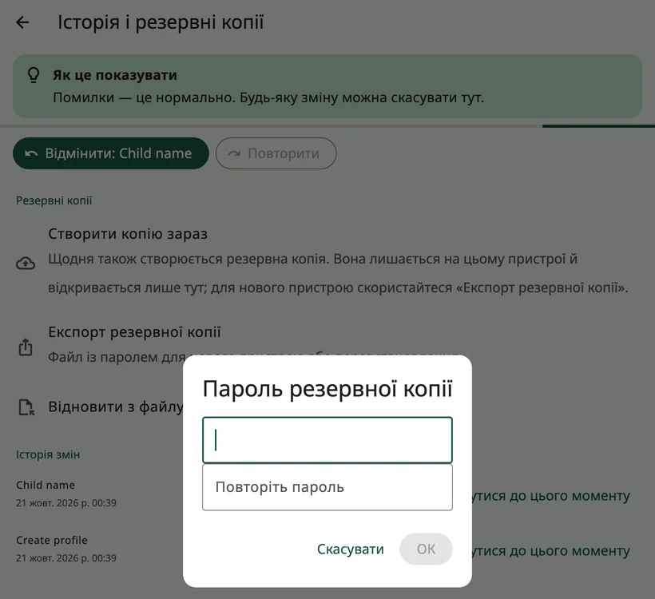
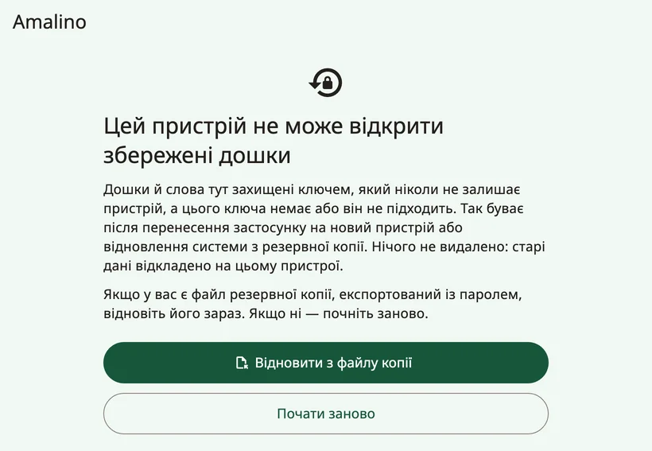
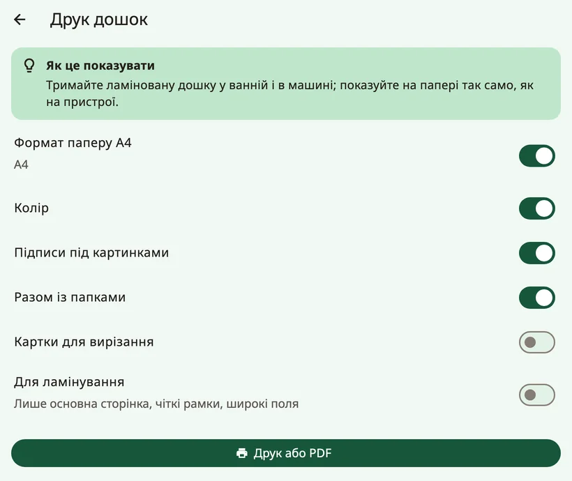

<!-- description: Як зробити резервну копію дошок Amalino, перенести їх на новий пристрій, обмінюватися дошками з іншими застосунками АДК і друкувати паперові дошки. -->
# Обмін і друк

Дошки дитини — це скарб: місяці слів, фото й записів. Ось як зберегти їх у безпеці, перенести на інший пристрій і роздрукувати.

## Резервні копії

Відкрийте налаштування для дорослих і виберіть **{app:historyBackups}**.

- Резервна копія створюється **автоматично щодня**. Вона залишається на пристрої й відкривається лише на тому пристрої, де її створено, тож захищає від помилок, але не від втрати пристрою.
- Кнопка **{app:backupNow}** одразу створює ще одну копію.
- Функція **{app:exportBackup}** створює файл, захищений паролем, для нового пристрою або для перевстановлення застосунку. Виберіть пароль, який ви не забудете, і зберігайте файл не на самому пристрої, а деінде: на компʼютері, у хмарному сховищі або в листі самому собі.

Якщо поза пристроєм копії немає або остання старша за місяць, у налаштуваннях для дорослих зʼявиться ненавʼязливе нагадування з кнопкою **{app:backupReminderMake}** (але ніколи впродовж перших двох тижнів нового профілю). Кнопка **{app:notNow}** приховує його на два тижні.

### Власна резервна копія пристрою

- **iPhone та iPad**: якщо ви створюєте резервну копію пристрою в iCloud або на компʼютері, дані Amalino теж до неї потрапляють.
- **Android**: дані Amalino не копіюються до вашої резервної копії Google і не переносяться на інший пристрій. Щоб перейти на новий пристрій, скористайтеся функцією **{app:exportBackup}**.

## Перехід на новий пристрій

1. На старому пристрої відкрийте налаштування для дорослих, потім **{app:historyBackups}** (у розділі **{app:sectionData}**) → **{app:exportBackup}** і задайте пароль.
2. Надішліть файл на новий пристрій через AirDrop, Quick Share, електронну пошту, хмарне сховище або USB-кабель.
3. Установіть Amalino на новому пристрої. На першому екрані налаштування натисніть **{app:alreadyUse}**, потім **{app:restoreBackup}** і **{app:chooseFile}**.
4. Введіть пароль.

Щоб відновити дані на пристрої, який уже налаштовано, скористайтеся кнопкою **{app:importBackup}** у розділі **{app:historyBackups}**. Усі дошки, записи й журнали на пристрої буде замінено; перед цим Amalino створить резервну копію того, що є на пристрої зараз.

Автоматичну резервну копію з іншого пристрою відновити не можна: вона відкривається лише на тому пристрої, де її створено. Використовуйте копію, експортовану з паролем.

## Якщо Amalino не може відкрити збережені дошки

Дошки захищено ключем, який ніколи не залишає пристрою. Якщо цього ключа немає або він не збігається — наприклад, після перенесення застосунку на новий пристрій чи відновлення системної резервної копії, — Amalino під час запуску показує екран **{app:dataRecoveryTitle}**. Нічого не видалено: старі дані зберігаються окремо на пристрої.

- **{app:dataRecoveryRestore}**: виберіть резервну копію, яку ви експортували з паролем, і введіть пароль.
- **{app:dataRecoveryFresh}**: пройдіть налаштування ще раз.

Якщо колись побачите повідомлення **{app:startupFailedTitle}**, повністю закрийте застосунок і відкрийте його знову. Якщо це повторюється, перезавантажте пристрій. Ваші дошки не видалено.

## Обмін дошками з іншими застосунками АДК

Функція **{app:openBoardFormat}** у групі **{app:sectionData}** налаштувань для дорослих переносить дошки в інші застосунки АДК і з них, якщо вони підтримують цей відкритий формат дошок:

- **{app:exportAllBoards}** або **{app:exportThisBoard}**.
- **{app:importObz}**, наприклад із Cboard. Імпортовані дошки додаються як папки. Amalino повідомляє, скільки кнопок йому вдалося повʼязати зі словами, які він знає.

Імпортувавши дошку, перевірте, чи її слова стоять на місцях, які дитина вже знає.

## Друк

Функція **{app:printBoards}** створює паперову копію — для купання, басейну, подорожі або на випадок, якщо пристрій зламався.

- **{app:paperA4}**: сторінки формату A4.
- **{app:colour}**: вимкніть, щоб друкувати чорно-білим.
- **{app:showLabels}**: під кожною картинкою друкується слово.
- **{app:includeFolders}**: друкуються не лише головна дошка, а й сторінки папок.
- **{app:cutOut}**: окремі картинки, щоб вирізати.
- **{app:waterproof}**: лише сторінка з основними словами, з чіткими рамками й широким полем.

Натисніть **{app:printOrSave}**, щоб надрукувати або зберегти PDF-файл і надрукувати його пізніше.

> **Порада.** Тримайте заламіновану дошку з основними словами у ванній і в автомобілі й показуйте слова на папері так само, як на пристрої.

Далі: [Поради для родин](tips-for-families.md).
