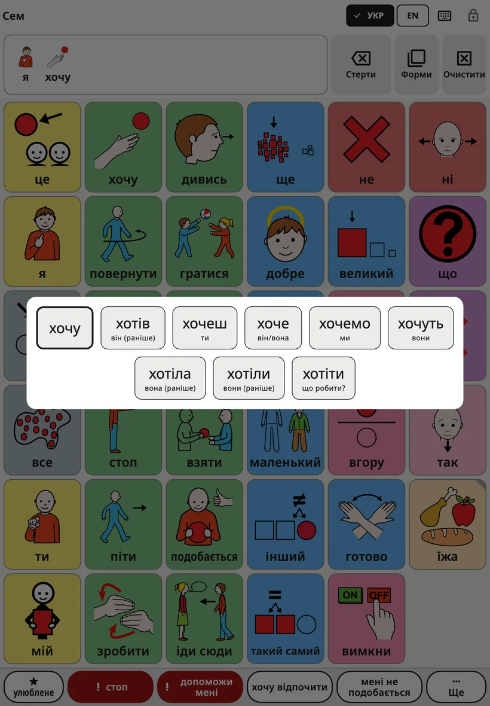
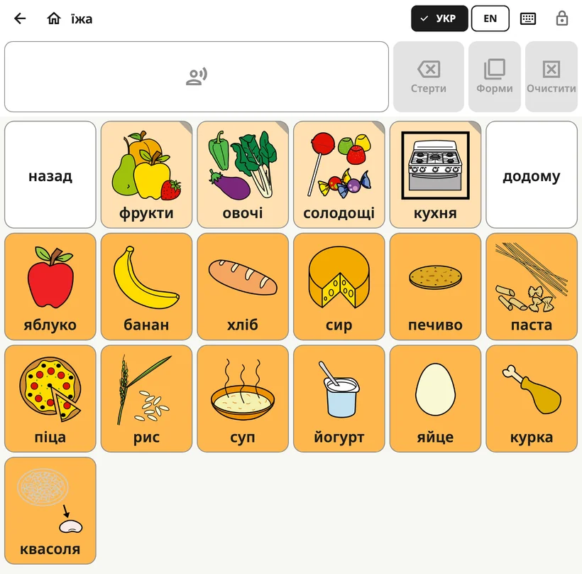

<!-- description: Що бачить дитина в Amalino: дошка, верхня панель, рядок повідомлення, форми слів, як промовити речення й перемкнути мову. -->
# Дошка дитини

Дошка — це екран, яким дитина користується цілий день. Налаштування для дорослих заблоковані, тож дитина може вільно все досліджувати.

## З чого складається екран

Згори донизу:

1. **Верхня панель**: імʼя дитини (а в папці — назва дошки), кнопки мов, кнопка клавіатури й замок.
2. **Рядок повідомлення**: слова, які вибрала дитина, а поруч кнопки **{app:barDelete}**, **{app:barForms}** й **{app:barClear}**.
3. **Дошка**: кнопки з картинками й словами.
4. **Рядок фраз**: «{app:favourites}», «стоп», «допоможи мені», дві фрази родини й «{app:quickMore}». Докладніше — на сторінці [Швидкі фрази і «Ще»](quick-phrases.md).

## Як промовити слово й речення

Коли дитина натискає кнопку, її слово звучить уголос і додається до рядка повідомлення. Якщо натиснути ще кілька кнопок, складеться речення: «я», «хочу», «ще».

- **Натисніть на рядок повідомлення**, щоб промовити все речення.
- **{app:barDelete}** прибирає останнє слово.
- **{app:barClear}** очищає все повідомлення.

Як це працює, можна змінити в розділі **{app:sectionSettings}** → **{app:messageBar}**: наприклад, щоб слова звучали лише після натискання на повідомлення або щоб повідомлення очищалося після того, як прозвучить.

## Форми слів

Слова змінюються: «собака» і «собаки», «йти» і «пішов», «великий» і «більший». Меню форм слова показує інші форми у вигляді великих кнопок. Натискання на форму додає її до повідомлення й промовляє. Початкове слово завжди стоїть першим, тож дитина завжди може до нього повернутися.

Відкрити меню можна трьома способами:

- **Утримуйте слово** на дошці якусь мить.
- **Утримуйте рядок повідомлення**, щоб змінити останнє слово.
- Натисніть **{app:barForms}** поруч із рядком повідомлення. Ця кнопка змінює останнє слово; якщо в нього немає інших форм, вона сіра.

Якщо для дитини задано **{app:holdTime}** (у налаштуваннях для дорослих: **{app:sectionSettings}** → **{app:touchAccess}**), утримування слова просто його промовляє. Тоді, щоб відкрити форми слова, натискайте **{app:barForms}**.

Меню ввімкнене в усіх мовах. Щоб його вимкнути, відкрийте **{app:sectionSettings}** → **{app:messageBar}** → **{app:grammarHelper}**.

## Папки

Деякі кнопки відкривають папку зі спорідненими словами, наприклад «їжа», «місця» чи «почуття». У кнопки папки загнутий куточок.

У папці на верхній панелі зʼявляються стрілка **{app:back}** і кнопка **{app:home}**. Кнопка **{app:home}** завжди повертає на головну дошку.

## Як перемкнути мову

Якщо дитина користується кількома мовами, на верхній панелі є кнопка для кожної з них (EN, DA, ES, РУС, УКР, عربي, LT). Один дотик перемикає всю дошку. Кожне слово залишається на тому самому місці в усіх мовах.

На менших екранах замість цього є одна кнопка мови, яка відкриває короткий список.

## Чому кнопки ніколи не переїжджають

Кожне слово має на дошці своє місце й там і залишається. Дитина запамʼятовує, де які слова, так само як ви запамʼятовуєте, де літери на клавіатурі, — і невдовзі знаходить їх, не дивлячись.

Тому:

- коли планшет повертають, розташування кнопок на дошці не змінюється;
- на телефоні дошка за замовчуванням завжди вертикальна (це можна змінити: **{app:sectionSettings}** → **{app:boardLayout}** → **{app:boardOrientation}**);
- нові слова з часом зʼявляються на своїх місцях і не відсувають інші. Докладніше — на сторінці [Слова і папки](words-and-folders.md).

## Замок

Замок у правому верхньому куті відкриває налаштування для дорослих. Утримуйте його 3 секунди, а потім розвʼяжіть простий приклад на цифрових кнопках (або введіть PIN-код, якщо ви його задали). Коротке натискання нічого не робить, тож дитина не відкриє налаштування випадково.

Як зробити, щоб дитина не могла вийти із застосунку, читайте в пункті **{app:lockAndKeep}** на сторінці [Налаштування](settings.md).

## Попередження на дошці

Якщо батарея майже розряджена або звук вимкнений чи тихий, під верхньою панеллю зʼявляється короткий рядок про це, наприклад «{app:warn.muted}».

Далі: [Слова і папки](words-and-folders.md).
