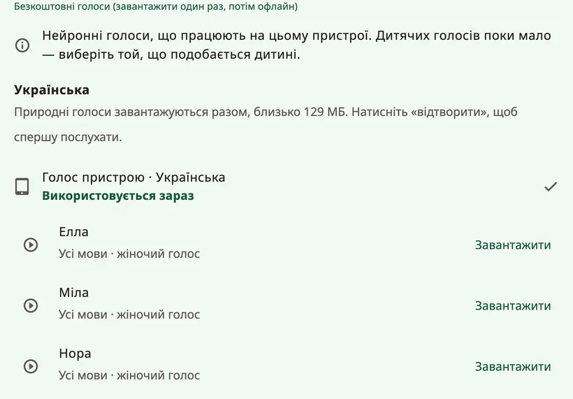

<!-- description: Як звучатиме дитина в Amalino: природні голоси, голос пристрою, записи, вік голосу, швидкість і вимова імені дитини. -->
# Голоси

Голос застосунку — це голос дитини. Дайте дитині послухати кілька голосів і вибрати той, що їй до вподоби. Змінити голос можна будь-коли: **{app:sectionSettings}** → **{app:speechVoice}**.

## Які бувають голоси

- **{app:naturalVoicesHeading}**: десять голосів (Ella, Mila, Nora, Sofi, Ida, Leo, Theo, Adam, Omar і Ben), які звучать найбільш по-людськи. Кожен із них говорить усіма сімома мовами Amalino. Одне завантаження охоплює всі голоси, а потім вони працюють без інтернету.
- **{app:systemVoice}**: голоси, які вже є в телефоні чи планшеті. Нічого завантажувати не треба. Деяким із них може знадобитися інтернет — Amalino пише про це під голосом.
- **{app:personalVoice}** (iPhone та iPad, iOS 17 або новіша): голос, який ви створили в параметрах пристрою, у розділі **Доступність → Особистий голос**. Amalino попросить дозволу ним користуватися. На Android особистого голосу немає: щоб зберегти голос когось із рідних, краще записуйте слова.
- **Ваші записи**: у редакторі кнопки можна записати будь-яке слово своїм голосом. Записи звучать замість голосу застосунку. Докладніше — на сторінці [Редагування й переміщення кнопок](editing.md).

Натисніть на голос, щоб його послухати, а потім натисніть **{app:useVoice}**.

## Один голос чи окремий для кожної мови

Для кожної мови голос налаштовується окремо. Оскільки кожен природний голос говорить усіма мовами дитини, можна натиснути кнопку на кшталт **{app:useForAll|voice=Ella}**, і для всього буде один голос. Інакше в реченнях, де змішано мови, голос змінюватиметься.

## Завантаження

Природні голоси завантажуються одним файлом розміром близько 129 МБ. Amalino спершу повідомляє розмір. Якщо ви на мобільному інтернеті, застосунок запитає дозволу перед завантаженням; щоб завантажити пізніше, виберіть **{app:waitForWifi}**. Доки завантаження не завершиться, говорить голос пристрою.

Щоб звільнити місце, видаліть природні голоси з пристрою: доки ви не завантажите їх знову, слова вимовлятиме голос пристрою.

## Як звучить голос

- **{app:speechRate}**: повільніше чи швидше.
- **{app:voiceAge}**: **{app:voiceAgeAdult}**, **{app:voiceAgeOlder}** або **{app:voiceAgeYoung}**, а також повзунок **{app:voiceAgeStrength}**. Це налаштування підвищує тон і змінює характер голосу. Звучатиме він радше як маленький дорослий, ніж як справжня дитина, тож подивіться, що сподобається дитині.
- **{app:pitch}**: лише для голосів пристрою, тому це налаштування видно, тільки коли говорить один із них. Для природних голосів замість нього є вік голосу.
- **{app:volume}**.
- **{app:lowerOthers.anon}**: музика й інші застосунки звучать тихіше — **{app:lowerOthersSpeaking}** або **{app:lowerOthersOpen}**, — щоб слова було краще чути.

## Збережене мовлення

Це налаштування — у розділі **{app:advanced}** наприкінці сторінки **{app:speechVoice}**. Щоб говорити без затримки, Amalino заздалегідь готує слова дошки вибраними голосами й зберігає їх на пристрої. Це відбувається у фоновому режимі, поки дошкою ніхто не користується. Пункт **{app:savedSpeech}** показує, скільки вже готово і скільки місця це займає. Якщо слова раптом звучать неправильно, кнопка **{app:savedSpeechRebuild}** підготує їх наново.

## Імʼя дитини

У налаштуваннях для дорослих виберіть пункт з імʼям дитини (наприклад, **{app:settingsChildName|name=Сем}**). Там можна:

- написати імʼя так, як воно пишеться кожною мовою, або коротку форму;
- послухати, як його вимовляє кожен голос;
- якщо звучить неправильно, написати в полі **{app:spokenAs}**, як воно має звучати, наприклад «Шон» для Sean.

Якщо й так звучить неправильно, запишіть імʼя своїм голосом.

## Для мови немає голосу

Якщо для якоїсь мови ще немає голосу, завантажте природні голоси. Або встановіть голос у параметрах синтезу мовлення на пристрої, або запишіть слова самі.

> **Порада.** Запитайте дитину, який голос їй подобається. Коли голос їй пасує, їй більше хочеться ним користуватися.

Далі: [Обмін і друк](sharing-and-printing.md).
