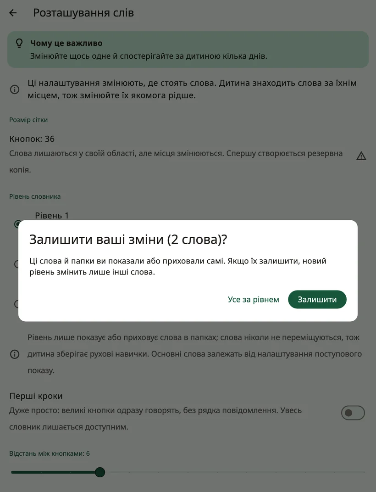

<!-- description: Як Amalino впорядковує слова: основні слова на постійних місцях, папки, розміри дошки, рівні словника й поступове відкриття прихованих слів. -->
# Слова і папки

В Amalino є близько 2 500 слів кожною з семи мов. Показувати їх усі одразу не потрібно. На цій сторінці пояснено, як упорядковано слова і як відкривати нові, коли дитина росте.

## Основні слова й папки

На **головній дошці** — основні слова: короткі повсякденні слова на кшталт «я», «хочу», «ще», «піти», «не», «допоможи» і «подобається». Близько 200 основних слів становлять більшу частину того, що люди кажуть щодня, тож із ними дитина може сказати дуже багато.

У **папках** — усе інше: їжа, місця, люди, почуття, іграшки тощо. Кнопка папки має загнутий куточок і відкриває сторінку зі спорідненими словами.

Коли дитина натискає слово в папці, Amalino повертається туди, звідки вона прийшла, і чекає на наступне слово: «я хочу», потім папка **їжа**, «яблуко» — і основні слова знову під рукою, щоб додати «будь ласка». Для папок, де дитина вибирає кілька слів поспіль (наприклад, кольори), вимкніть для цієї папки налаштування **{app:folderGoBack}** (див. [Редагування й переміщення кнопок](editing.md)). У папці **{app:favourites}** воно від початку вимкнене.

## Розмір дошки

Розмір дошки (**{app:gridSize}**) — це кількість кнопок на одній сторінці:

- **20**: великі кнопки, у них легше влучити
- **36**: середні, добрий початок для більшості малих дітей
- **60**: менші, більше слів на одній сторінці
- **84**: маленькі, для впевнених користувачів

Під час налаштування застосунок пропонує розмір залежно від віку дитини й того, як вона торкається екрана. Кожен пристрій пропонує лише ті розміри, за яких кожна кнопка має щонайменше 44 точки завширшки (близько 7 мм — зручно для пальця).

Намагайтеся не змінювати розмір. Від цього слова переїжджають на нові місця, і дитині доводиться вивчати їх наново. Amalino попросить підтвердження й спершу зробить резервну копію. Краще розширюйте дошку, відкриваючи більше слів.

## Слова ніколи не переїжджають

Кожне слово має своє місце й не втрачає його. Коли слово приховане, його місце порожнє; коли пізніше слово відкривають, воно зʼявляється саме там. Ніщо не зсувається, щоб звільнити місце.

## Рівень словника

У розділі **{app:sectionSettings}** → **{app:boardLayout}** пункт **{app:vocabLevel}** визначає, скільки слів буде в папках:

- **{app:levelDesc1|label}**: близько 400 слів — основні слова й перші слова в папках
- **{app:levelDesc2|label}**: близько 1 300 слів, папок більше
- **{app:levelDesc3|label}**: усі слова (близько 2 500)

Рівень лише показує або приховує слова в папках. Слова на головній дошці відкриваються по одному (див. нижче).

Якщо ви вже самі показували чи приховували слова в папках, Amalino спершу запитає, чи залишити ваші зміни. Кнопка **{app:keepOwnChangesKeep}** змінює лише інші слова, а **{app:keepOwnChangesReset}** — переводить усі слова на новий рівень.

## Як показувати й приховувати слова

Кожне слово або **видно** дитині, або воно **приховане**. Місце прихованого слова дитина бачить порожнім, і більше нічого не зсувається.

Щоб переглянути й змінити це, відкрийте налаштування для дорослих і виберіть **{app:editBoard}**. Приховані слова зʼявляться на своїх місцях — затемнені й із перекресленим оком. Натисніть на таке слово, у його редакторі ввімкніть **{app:visibility}**, а потім натисніть **{app:done}**. У папках це працює так само.

У режимі показу сторінка папки поводиться так само: приховані слова видно блідими, а око в рядку показу відкриває всі слова цієї папки одразу.

> **Порада.** Відкривайте нове слово лише тоді, коли ви вже багато разів його показали. У режимі показу приховані слова видно блідими на своїх місцях: натискайте їх, коли говорите, а коли дитина буде готова, утримуйте слово й виберіть **{app:showToChild}**. Докладніше — на сторінці [Налаштування: режим показу](settings.md).

## Як знайти слово

Не памʼятаєте, де слово? Увімкніть **{app:modellingMode}**, натисніть **{app:showMeWhere}** і введіть слово. Amalino покаже шлях до нього, кнопку за кнопкою, тож ви зможете самі натиснути його, поки говорите.

## Ваші власні слова

Можна додавати слова, змінювати картинки, записувати слово своїм голосом, створювати нові папки або додавати вбудовані. Докладніше — на сторінці [Редагування й переміщення кнопок](editing.md).

Далі: [Швидкі фрази і «Ще»](quick-phrases.md).
